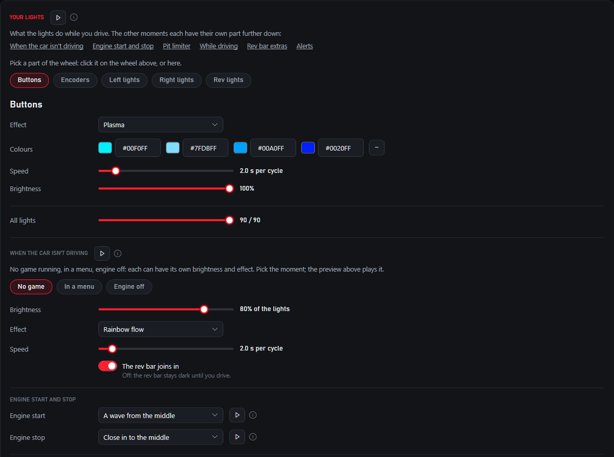
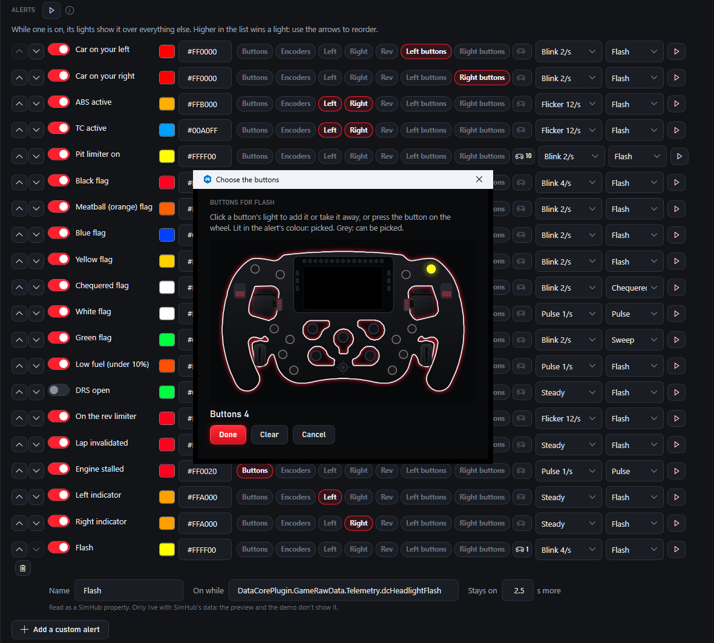
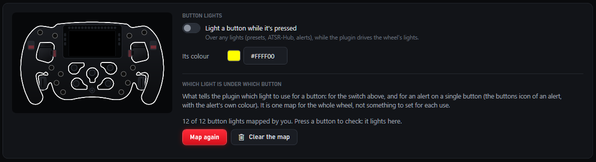
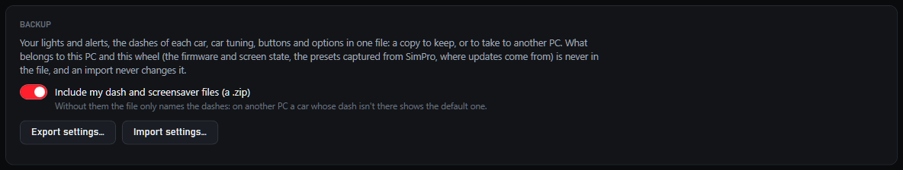

  

  An enhanced edition of <a href="https://github.com/fxunleashed/fx-unleashed"><b>FX Unleashed</b></a>, the free SimHub
  plugin for the Simagic FX Pro, GT Neo and FX: more ways to see your lights on the wheel while you set them up, alerts on
  single buttons, measured shift lights for some iRacing cars, and a backup of your settings.

> [!IMPORTANT]
> **Use the original FX Unleashed.** It is ziadkadry99's work, and the project to use and support:
> [fxunleashed/fx-unleashed](https://github.com/fxunleashed/fx-unleashed) and [fxunleashed.com](https://fxunleashed.com).
> This edition is just my own changes for my own use case; I decided to make it public in case someone finds them
> helpful. My dashes and my lights profile are in [fx-unleashed-dashes](https://github.com/skuldgerry/fx-unleashed-dashes).

> **An independent community project.** FX Unleashed Enhanced is a modified version of FX Unleashed by ziadkadry99. It
> is not made or supported by the FX Unleashed project, and neither is affiliated with, endorsed by or supported by
> Simagic. Simagic, FX Pro and SimPro Manager are trademarks of their owners, used only to say which hardware this works
> with. The software is provided "as is", without warranty of any kind. Use it at your own risk.

## Built on FX Unleashed

All the real work behind this plugin is **[FX Unleashed](https://github.com/fxunleashed/fx-unleashed)** by
**ziadkadry99** and its contributors: the plugin itself, Unleashed mode and its custom firmware, the dash format and
designer, the library, the lights engine and everything else. Its website is **[fxunleashed.com](https://fxunleashed.com)**.
This edition follows each FX Unleashed release (currently **0.7.6**) and adds the changes below on top.

For setup, the custom firmware, dashes, the library and everything not listed here, the original documentation applies:
its **[README](../README.md)**, its **[setup guide](../docs/setup.md)** and its website. Every change of this edition is
listed in [CHANGES-ENHANCED.md](../CHANGES-ENHANCED.md).

## [Dashes and tools](https://github.com/skuldgerry/fx-unleashed-dashes)

My dashes for the FX Pro's screen (replicas of iRacing GT3 displays and a default dash based on the Lovely Dashboard),
my lights profile, and the tools used to make, check and measure them.

## What's added

### See it on the wheel, right where you edit it

Every part of the lights editor has a **play** button. Press it and the wheel stays in that state (driving, a menu, the
engine off, the start-up, the pit limiter...) with your lights, and **follows every change you make**: pick another effect,
colour or brightness and the wheel shows it at once. Press **stop**, leave the tab or start a game to give the wheel back.
An info mark next to each one says what you should see.

- **Show on the wheel**, top right of the preview, holds the state picked under "Preview as".
- Each **rev bar extra** (pit speed, refuelling, brake bias, launch aid...), the **encoder levels** and **every alert in
  turn** play their scripted scenario.

### Try any alert

Each alert has its own play button: the wheel shows it as if its moment had come, over the driving lights, and follows its
colour, lights, rhythm and style as you change them. No need to wait for a blue flag to see what it looks like.

### Alerts on single buttons

An alert can light **single buttons' own lights**, next to or instead of the light groups: press the alert's buttons icon
and pick them on a drawing of the wheel (click their lights, or press the buttons on the wheel). And a custom alert can
**stay on** for a number of seconds after its condition was last true, for values that only flicker on for an instant.

The example this was made for: the button you flash your headlights with lights up when the car really flashes. In
iRacing, `DataCorePlugin.GameRawData.Telemetry.dcHeadlightFlash` is true for only about 70 ms per press; with
**Stays on: 2.5 s** the button lights for the whole flash. Another: two buttons blinking while the pit limiter is on (a
custom alert on `pitLimiter`, with those two buttons picked).

<!-- animation: ../docs/enhanced/flash.gif -->

The FX Pro comes with its **usual button map**, so a button's light works without mapping the buttons first (map them
yourself if one lights the wrong light). The Button lights card now says what the map is for, separately from the colour
of "Light a button while it's pressed".

### Measured shift lights

FX Unleashed 0.7.6 reads iRacing cars' shift lights from the sim's files, but it keeps only each light's first colour:
on the BMW M4 GT3 the red and the two white dots never show. For the cars measured in the sim, this edition uses its own
data first:

- **BMW M4 GT3**: per gear, five green together, five light blue, all red, then two white dots in the middle (measured
  over a lap of the Nordschleife, 8460 frames);
- **McLaren 720S GT3**: the lights up to all blue, then red and blue on every other light one step later in every gear
  (measured from 2674 frames of the car's dash).

The game's own pit limiter lights are kept. Any car can also get **stages past the shift point** in Car tuning: the whole
bar in one colour, two colours on every other light, or only the middle lights, steady or blinking.

### A clearer lights editor

- "Your lights" says it is the look **while driving**, with links to every other part of the editor (not driving, engine
  start and stop, pit limiter, while driving, rev bar extras, alerts).
- The encoders' **setting levels** (ABS, TC, brake bias, DIFF, map) are a switch of their own, not one more effect in the
  list.
- An effect that **Hold still** or **Side lights dark** changes on track says so where you pick it.
- The two actions that move a car's shift lights earlier or later from a wheel button can be bound right in the rev lights
  editor.

### Backup and move your settings

**About > Backup**: export your lights, alerts, dashes per car, car tuning, buttons and options to one file, with your
dash and screensaver files in a zip if you like, and import them on this PC or another. What belongs to one PC and one wheel
(firmware and screen state, presets captured from SimPro, where updates come from) is never exported or imported. An
import is checked whole and applied the next time SimHub starts, after a copy of your current settings is kept.

## Install

1. Close SimHub.
2. Copy `User.FXProRpmSync.dll` from a release zip of this repository into your SimHub folder (normally
   `C:\Program Files (x86)\SimHub\`), replacing the one there. It is the same file name as the official plugin: **use one
   or the other**, not both.
3. Start SimHub. The plugin shows as **FX Unleashed Enhanced**; your settings, dashes and bindings are kept.

Updates come from this repository's releases (About tab). Settings from the official plugin are pointed here on the first
start, so an official update doesn't replace this edition by surprise.

**Going back to the official plugin:** install its DLL the same way, and in About > More set "Releases from" back to
`fxunleashed/fx-unleashed`. Your settings load there too; it ignores what it doesn't know (single-button alerts and their
hold time are dropped the next time it saves). Export a backup first.

## Building

As for FX Unleashed: `dotnet build -c Release -p:DeployToSimHub=false` with SimHub installed (it references SimHub's
DLLs), then `tools/UsbTest` for the offline checks. See the [original README](../README.md#build-test-release).

## License and credits

- **[FX Unleashed](https://github.com/fxunleashed/fx-unleashed)** by ziadkadry99 and contributors, GPL-3.0 or later.
  **This edition** by [skuldgerry](https://github.com/skuldgerry), under the same licence: see
  [LICENSE](../LICENSE), [NOTICE](../NOTICE) and [CHANGES-ENHANCED.md](../CHANGES-ENHANCED.md).
- Car rev light data, dashes and other credits: as listed in the [NOTICE](../NOTICE).
- No Simagic software is in this repository or its releases. The custom firmware for Unleashed mode is FX Unleashed's,
  from [fx-unleashed-firmware](https://github.com/fxunleashed/fx-unleashed-firmware).
